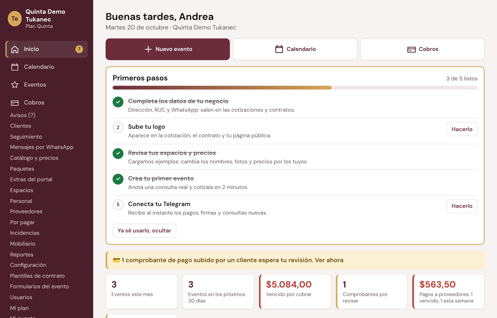
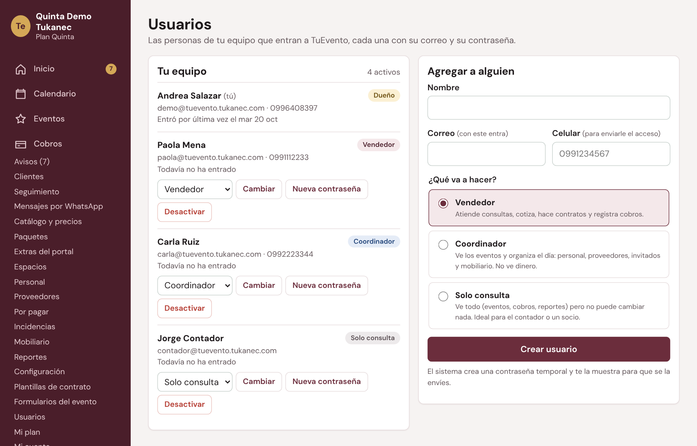
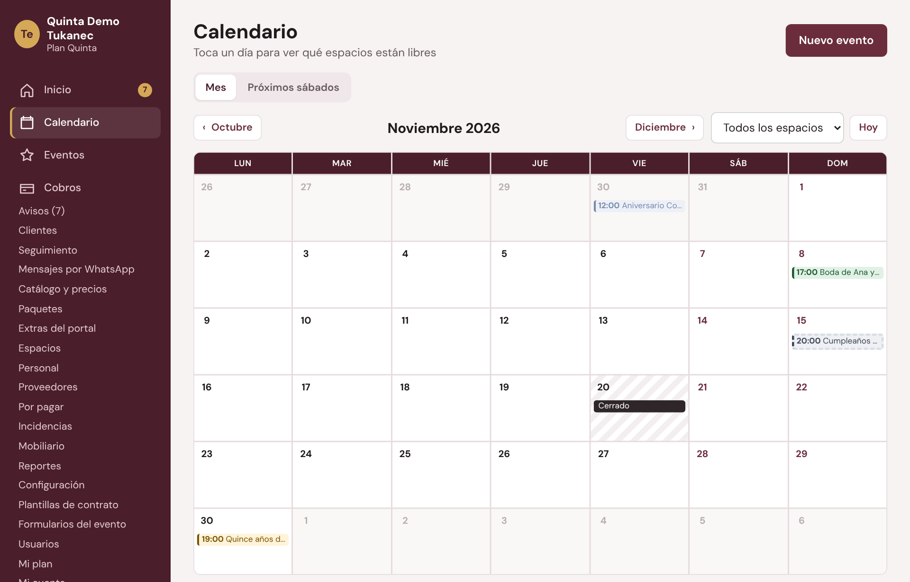
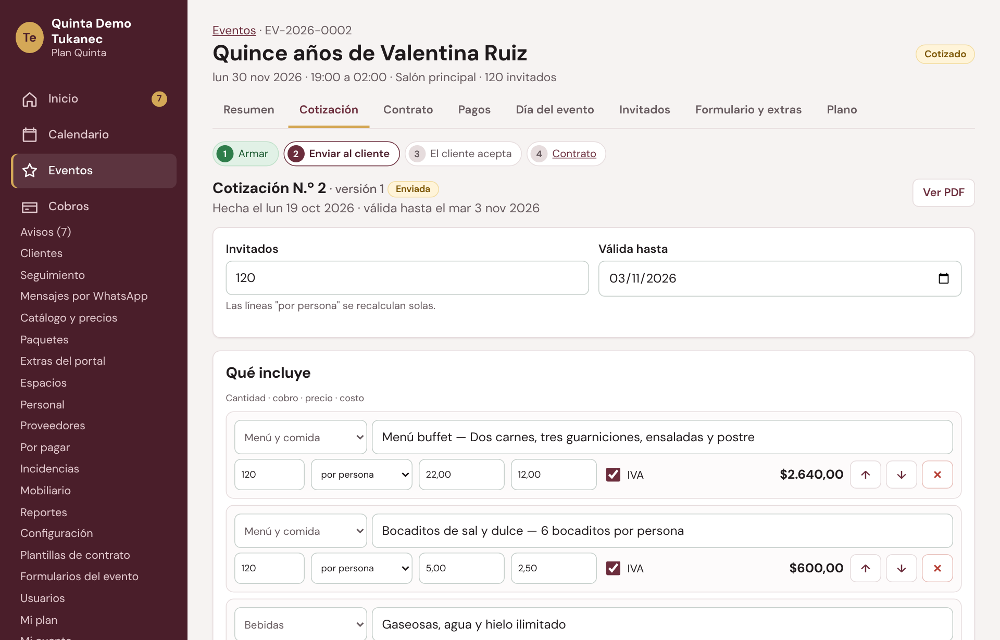
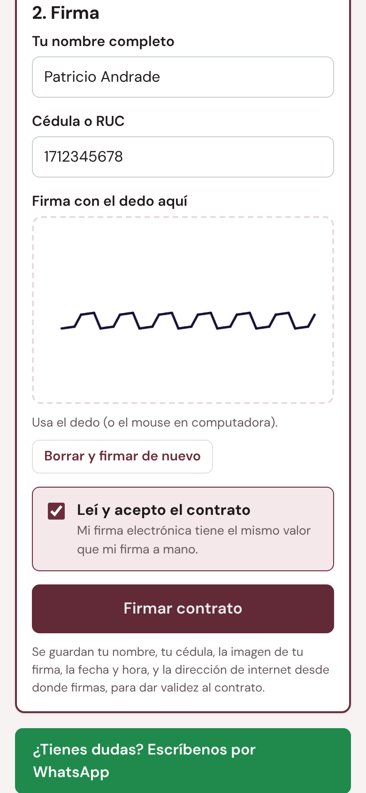
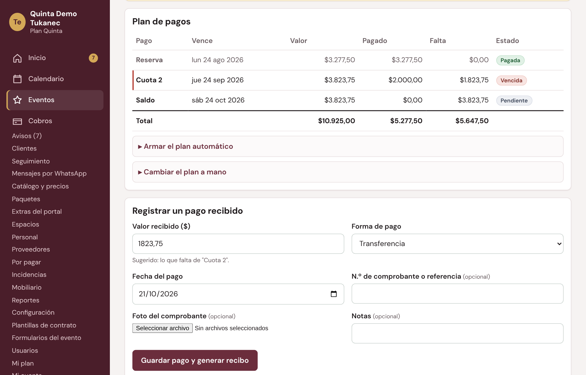
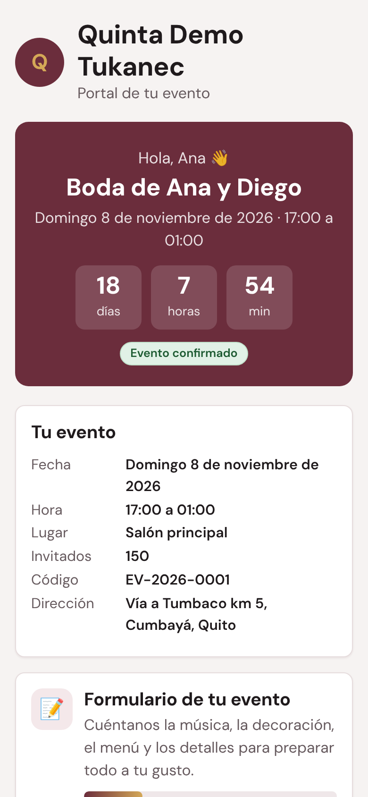
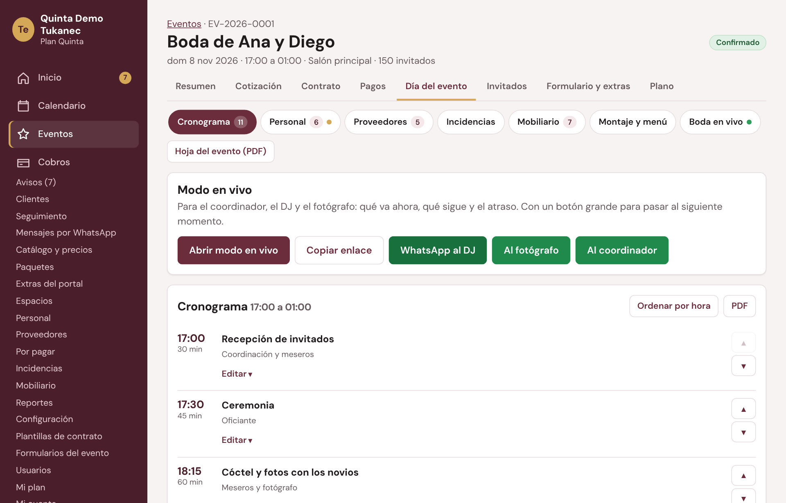
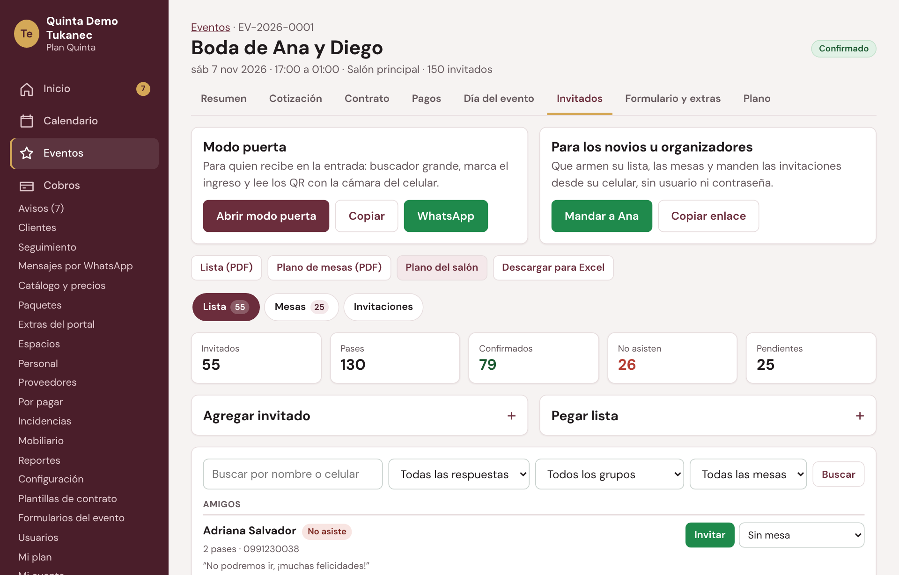
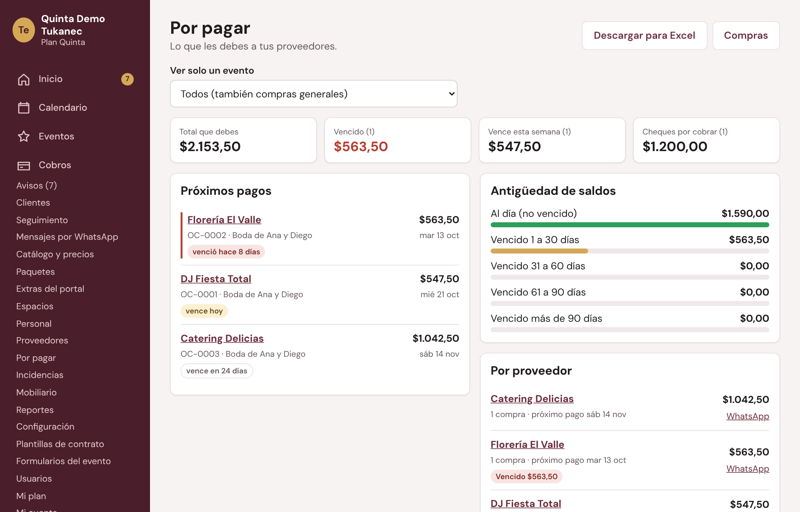

# Manual de TuEvento (por módulo)

Versión con capturas: [Manual_TuEvento.pdf](Manual_TuEvento.pdf). Las capturas están en [manual/capturas](manual/capturas) y salen del local de ejemplo «Quinta Demo Tukanec».
Para regenerar todo (base de ejemplo, capturas y PDF): `bash docs/manual/generar/generar.sh`.
Ayuda: WhatsApp 099 640 8397 · info@tukansoftware.com · tukansoftware.com

Cada parte dice si es de la **base** (la tienen todos) o de un **módulo** (se enciende en Mi plan). Si un módulo no está en tu plan, su pantalla dice «Este módulo no está en tu plan». Apagar un módulo nunca borra datos.

---

## 1. Qué es TuEvento y cómo se arma
Sistema para salones de eventos, quintas y haciendas de Ecuador. Celular, tablet o computadora, sin instalar nada.
- **Base:** calendario sin doble reserva y próximos sábados, eventos con estados, seguimiento, tareas y lista de espera, clientes, espacios y fechas cerradas, catálogo, cotizaciones (IVA, descuento, versiones, PDF con QR y enlace para aceptar), plan de pagos, recibos y comprobantes, mensajes de WhatsApp del día, página pública, reportes básicos, usuarios con cargos, app instalable.
- **Módulos:** Paquetes y simulador · Contratos con firma · Portal del cliente · Cobros en línea (Payphone) · Formulario, extras y encuesta · Día del evento · Invitados con QR · Plano del salón · Mobiliario y menaje · Boda en vivo · Proveedores y compras · Portal del proveedor · Incidencias y puntaje · Metas y reportes avanzados · Avisos por Telegram · Exportar a Excel y Google Calendar · **Asistente IA** (incluido en Quinta; en los demás planes, extra por cotización).
- **Planes:** Esencial (la base, 1 espacio, 2 usuarios), Salón (base + paquetes, contratos, portal y cobros en línea, formulario y encuesta, proveedores, incidencias, metas, Telegram y Excel; 2 espacios, 3 usuarios), Quinta (todo, incluido el Asistente IA, sin límites). Tukán cotiza por WhatsApp según los módulos.

## 2. Entrar y la pantalla de Inicio (base)
- Correo y contraseña → **Entrar**. La primera vez, cambia la contraseña temporal en **Mi cuenta**. Sin cuenta: **Solicitar demo**.
- Menú: a la izquierda en la computadora (con «Buscar evento o cliente…»); abajo en el celular: Inicio, Calendario, Eventos, Cobros y Más.
- **Primeros pasos:** completa los datos del negocio, sube tu logo, revisa espacios y precios, crea tu primer evento, conecta Telegram. **Ya sé usarlo, ocultar**.
- Inicio: cifras del mes, vencido por cobrar, comprobantes por revisar, pagos a proveedores, consultas sin atender, meta del mes, próximos 7 días, avisos, seguimientos de hoy, tareas, cuotas y consultas por atender.

## 3. Tu equipo: qué ve cada cargo (base)
| Cargo | Puede | No ve |
|---|---|---|
| Dueño | Todo, incluida la ganancia, configuración, usuarios, metas y Mi plan | — |
| Administrador (hasta 4) | Lo mismo que el dueño: menú, usuarios, configuración, Mi plan, metas y dinero. Crea, cambia y desactiva a otros administradores y usuarios. **No cuentan** en el límite de usuarios del plan | No puede cambiar ni desactivar al dueño, ni a sí mismo |
| Vendedor | Consultas, cotizaciones, contratos, cobros, clientes, catálogo, proveedores, reportes | Configuración, usuarios, Mi plan, metas, ganancia |
| Coordinador | El día del evento: cronograma, personal, proveedores, invitados, mobiliario, plano, formulario | Cobros, cotización, contrato y pagos |
| Solo consulta | Ve todo | No cambia nada |

**Más → Usuarios** (dueño o administrador) **→ Agregar a alguien** (nombre, correo, celular, ¿Qué va a hacer?: **Administrador (mismos permisos que el dueño)**, Vendedor, Coordinador o Solo consulta) → **Crear usuario** → contraseña temporal por WhatsApp. **Cambiar**, **Nueva contraseña**, **Desactivar**. **Mi cuenta**: datos, contraseña y Telegram (módulo).

- **Administradores:** hasta 4 además del dueño; arriba dice «Administradores: 2 de 4». Un quinto (al crear o activar) muestra «Puede tener hasta 4 administradores además del dueño». No cuentan en el límite de usuarios del plan (el dueño sí cuenta); si un administrador pasa a otro cargo, empieza a contar.
- **Solo del dueño:** ser la cuenta registrada en Tukán (contacto del negocio en el Panel Tukán Central y «Nueva clave del dueño» desde Tukán). Nadie, ni un administrador, cambia ni desactiva al dueño; nadie se cambia el cargo ni se desactiva a sí mismo.
- En este manual, «solo el dueño» vale también para los administradores.

## 4. Configuración (base, dueño y administradores)
Pestañas **Negocio** (datos, WhatsApp, reseña de Google, color, logo), **Reglas** (IVA, validez de la cotización, días de retención, % de reserva, número de pagos, días del saldo, garantía, hora máxima, montaje/desmontaje, invitados por mesero, comisión, condiciones), **Cobros en línea** (transferencia, DeUna y claves de Payphone), **Página pública** (enlace y QR), **Tareas** (lista de cada evento), **Google Calendar** (módulo Exportar) y **Más**.

## 5. Espacios, fechas cerradas y planos
- **Más → Espacios → Nuevo espacio:** nombre, alquiler, capacidad sentados y de pie, descripción, color, foto. Un espacio nunca se vende dos veces a la misma hora.
- **Fechas cerradas:** fecha, todo el local o un espacio, motivo → **Cerrar fecha** / **Abrir**.
- **Planos del salón** (módulo): **Nueva distribución** vacía, de boda/quince o corporativa.

## 6. Catálogo, paquetes y extras
- **Catálogo y precios → + Agregar producto:** categoría, cómo **Se cobra** (persona, evento, hora, unidad), **Precio al cliente**, **Lo que te cuesta** → **Agregar al catálogo**. Subir precios en bloque.
- **Paquetes** (módulo): **+ Crear paquete**, **Duplicar**, **¿Cuánto sale?**
- **Extras del portal** (módulo Formulario, extras y encuesta): qué puede pedir el cliente solo.

## 7. Calendario y evento nuevo (base)
- Calendario por mes y espacio, **Próximos sábados**, tocar un día para ver qué está libre.
- **Nuevo evento:** Cliente (nuevo o registrado, ¿Cómo nos conoció?), Evento (¿Qué celebran?, fecha, horas, invitados, montaje, espacios), Venta (presupuesto, vendedor, notas) → **Crear evento**. Nace como Consulta.
- Estados: Consulta → Cotizado (fecha retenida) → Separado (pagó la reserva, bloqueado) → Confirmado (contrato firmado) → Realizado; Perdido / Cancelado con motivo.
- Fecha ya separada: **Guardarlo igual como consulta** = lista de espera. **Eventos**: lista y **Tablero de ventas**.

## 8. Un evento por dentro
Pestañas Resumen, Cotización, Contrato, Pagos, Día del evento, Invitados, Formulario y extras, Plano (las de módulos apagados no salen). En el Resumen: estado, datos, cliente, menú y detalles, tareas, dinero, cotización y contrato, portal del cliente, **Coordinador del día → Asignar**, seguimiento, **Copiar a otra fecha**, historial.

## 9. Seguimiento, clientes y mensajes (base)
- **Seguimiento:** atrasadas, para hoy, próximos 7 días (Hecho, WhatsApp, Llamar, Reagendar), consultas sin atender, cotizaciones sin respuesta, fechas retenidas que vencen.
- **Mensajes por WhatsApp:** cuotas, lista de invitados, formularios sin llenar, contratos, encuesta… **Enviar por WhatsApp** y **✓ Marcar como enviado**.
- **Clientes:** ficha con eventos, contratado, pagado y deuda. **Página pública:** las consultas entran solas como Consulta.

## 10. La cotización (base)
1. Pestaña Cotización → **Desde un paquete** o **En blanco** → **Crear cotización**.
2. Ajusta líneas, **Agregar del catálogo**, **Agregar un paquete completo**, descuento → **Guardar**. Ganancia solo para el dueño y los administradores.
3. **Enviar por WhatsApp** / **Copiar enlace** → el cliente la ve y toca **Aceptar cotización**; o **El cliente aceptó**.
4. Aceptada → valor del evento y plan de pagos. Cambios: **Nueva versión**.

## 11. Contrato con firma (módulo)
**Generar contrato** → revisar (**Guardar cambios**) → **Enviar para firmar por WhatsApp** o **Dejar listo para firmar** → el cliente firma con el dedo (nombre, cédula, **Leí y acepto el contrato**, **Firmar contrato**). Con la reserva pagada pasa a Confirmado. QR y huella de verificación, **Anular este contrato**, plantillas con variables `{{cliente}}`, anexos por extras.

## 12. Pagos y cobros (base; tarjeta con Cobros en línea)
- Plan automático según las reglas (reserva, cuotas, saldo); **Armar el plan automático** / **Cambiar el plan a mano**.
- **Registrar un pago recibido** → **Guardar pago y generar recibo**. Al completar la reserva el evento se separa solo. Pagos se anulan, no se borran.
- Comprobantes del cliente: **Confirmar: el dinero llegó** / **Rechazar**. Garantía por daños aparte. Gastos y ganancia real del evento.
- **Cobros:** cobrado, por cobrar, vencido, comprobantes, cuotas vencidas y por vencer, garantías por devolver.

## 13. Portal del cliente (módulos)
Enlace secreto sin claves: datos del evento, documentos, pagos (subir comprobante, pagar con tarjeta), invitados, cronograma, Ver en vivo. **Formulario del evento** (se guarda solo, hasta X días antes, **Listo, enviar al local**), **extras** (el local aprueba con **Aprobar y sumar al evento** o **No aprobar**) y **encuesta** de satisfacción con reseña en Google.

## 14. Día del evento (módulo)
Cronograma (ejemplo por tipo, agregar momentos, PDF), **modo en vivo** (ahora, sigue, atraso), personal con su enlace (confirmó, asistió, pagado), proveedores del evento (módulo Proveedores), incidencias, mobiliario (módulo), montaje y menú, boda en vivo (módulo) y **Hoja del evento (PDF)**.

## 15. Invitados con QR y plano (módulos)
**Agregar invitado** o **Pegar lista**, **Crear mesas**, **Invitar** por WhatsApp, invitación con QR, enlace para los novios, **Abrir modo puerta** (lee los QR), PDF y Excel. Plano del evento con mesas unidas a los invitados, **Sentar invitados**, **PDF para imprimir**.

## 16. Proveedores y compras (módulos)
Ficha (RUC, banco, crédito, documentos que vencen, bitácora), **Nueva compra o pedido de precio** (OC con PDF y QR), comparar precios, factura a mano o **Subir factura electrónica** (XML del SRI), pagos (cheque posfechado), **Por pagar** con antigüedad de saldos. Portal del proveedor («Ya llegué», subir factura). Incidencias y puntaje configurable.

## 17. Reportes y metas
Periodos Este mes / Mes pasado / Este año / Otras fechas. Secciones: Ventas, Cobrado, Por cobrar, Ocupación (base); Conversión, Ganancia, Comisiones, Metas (módulo Metas); Satisfacción (módulo Formulario, extras y encuesta); Descargas para Excel (módulo Exportar). **Metas de ventas** del local y por vendedor.

## 18. Mi plan, módulos y demos
**Más → Mi plan:** tus módulos encendidos; los que no tienes dicen «Precio por cotización» y tienen **Pedir cotización** (también en la pantalla del módulo apagado y en cada plan); **Preguntar por WhatsApp** para renovar (Tukán te cotiza). Demos: **Solicitar demo** → Tukán la prepara con datos de ejemplo y todos los módulos por los días acordados; al terminar, «Tu demo terminó» y los datos quedan guardados.

## 19. Ayuda e inteligencia artificial
- **Ayuda (base, todos los planes y cargos):** **Más → Ayuda** → cuadro **¿Qué necesita hacer?** (hasta 500 letras) → **Preguntar**. Responde al instante y paso a paso con este manual. Las preguntas que ya se hicieron quedan guardadas (Tukán las revisa) y salen de inmediato. Hasta 10 preguntas por minuto. Si no sirvió: **WhatsApp 099 640 8397**.
- **Asistente IA (incluido en el plan Quinta; en los demás, «Pídalo y le cotizamos» en Mi plan):** en **Eventos** o **Nuevo evento** → **✨ Desde un mensaje de WhatsApp** → pega el mensaje del cliente («boda de 150 personas el 14 de febrero con DJ…») → **Proponer la cotización** → borrador con cliente, tipo, fecha, horas, invitados, espacio, paquete y productos de **tu catálogo** (lo que no tienes va en notas; lo que falta preguntar, en **Falta preguntarle al cliente**) → revisa → **Guardar evento y cotización** (evento en Consulta y cotización en borrador; no se envía nada al cliente).
- Si no se puede leer el mensaje automáticamente: «En este momento no pudimos procesar el texto automáticamente; puede hacerlo a mano aquí» con el enlace a **Nuevo evento**. Sin el módulo, el botón no aparece.
- Para Tukán: la IA se configura una vez en el servidor (`/etc/tukan-ia.env`, `bash deploy/configurar_ia.sh` del Panel Tukán Central). Sin ese archivo la Ayuda responde con las preguntas guardadas y el manual. Gasto por negocio y mes con tope (4,00 USD con el módulo, incluido o comprado aparte; 0,50 USD sin él; Tukán lo cambia desde el Panel con «Tope de IA»), en el Panel → Más → IA. Preguntas guardadas: Panel de TuEvento → **Preguntas IA**.

## 20. Preguntas frecuentes
- **¿Dos vendedores pueden vender la misma fecha?** No: lo impide la base de datos.
- **¿Cuándo se separa la fecha?** Al completar la reserva. Mientras está cotizada, se retiene (botón **Retener** para dar más días).
- **¿El comprobante subido ya cuenta?** Solo después de **Confirmar: el dinero llegó**.
- **¿Me equivoqué en un pago?** **Anular** con motivo.
- **¿El coordinador ve dinero?** No.
- **¿Olvidé mi contraseña?** El dueño o un administrador te da una **Nueva contraseña**; el dueño escribe a Tukán.
- **¿Dónde pregunto cómo se hace algo?** En **Más → Ayuda** (capítulo 19).
- **¿Hace facturas electrónicas?** No; sí lee el XML de las facturas de tus proveedores.
- **¿Cuánto cuesta?** Depende de los módulos: escríbenos y te mandamos la cotización.
